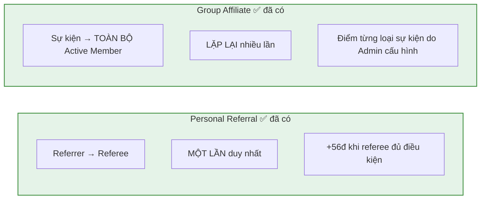
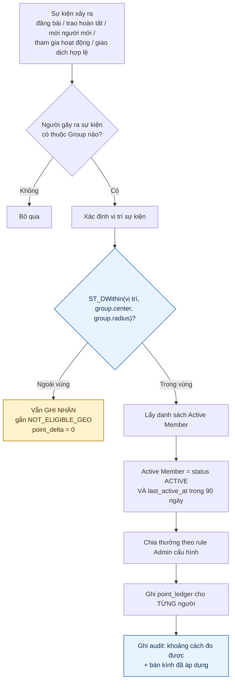
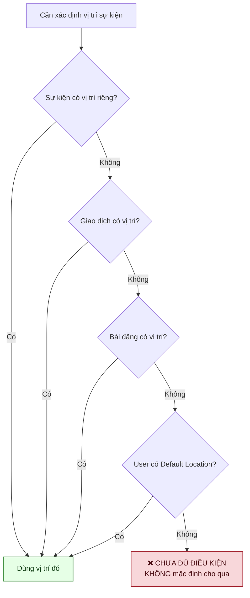
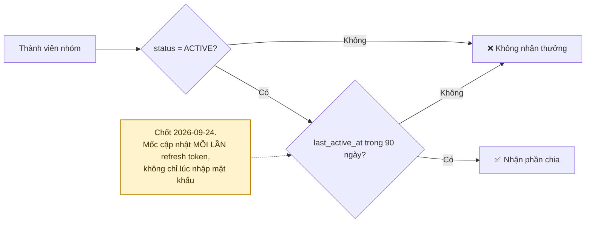
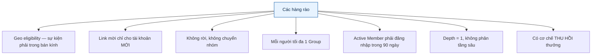

# 19 · Group Affiliate & điều kiện địa lý

Trạng thái: ✅ **bộ máy chia thưởng đã hiện thực** — migration `1797400000000-CreateAffiliateEngine`
dựng ba bảng `affiliate_policy_revisions` · `affiliate_events` · `affiliate_rewards`; sự kiện ghi
qua `recordEvent` từ repository bài đăng (`POST_CREATED`) và giao dịch (`GIFT_COMPLETED`); cổng
địa lý `ST_DWithin`, trần ngày theo người nhận và thu hồi đều có. Chỉ chia điểm khi chính sách
đang hiệu lực có `enabled: true` (`PUT /admin/affiliate-policy`). Thiết kế theo SRS §3.7A
(BR-AFF) và CHỐT-06.

## 19.1 Affiliate khác Personal Referral thế nào

## 19.2 Luồng xử lý một sự kiện affiliate

> **Vì sao ngoài vùng vẫn ghi nhận chứ không bỏ đi.** Bỏ đi thì khi có tranh chấp "vì sao sự
> kiện của tôi không được tính", không có gì để tra. Ghi kèm lý do `NOT_ELIGIBLE_GEO` trả lời
> được câu đó.
>
> **Vì sao audit phải lưu cả khoảng cách lẫn bán kính.** Bán kính là snapshot lúc tạo Group;
> nếu về sau Admin sửa cấu hình, không có hai con số này thì không dựng lại được phán quyết
> cũ (F58).
>
> ⚠️ **`groups.radius_km` là KM, còn `ST_DWithin` trên `geography` nhận MÉT.** Câu cổng địa lý
> phải nhân 1000, và đó là chỗ duy nhất trong phân hệ này có thể lệch đơn vị mà không báo lỗi.
> Ba khoá cấu hình `group.*_radius_meters` đặt tên bằng mét đúng như mọi khoá bán kính khác;
> chỗ đổi sang km nằm ở đúng một hàm, `resolveGroupRadiusKm`.
>
> Bẫy này đã cắn một lần: tới 30/09 bán kính đọc từ `capability.limit` của `CREATE_GROUP` — một
> ô số trần Admin sửa được, không nói đơn vị — rồi kẹp bằng cận **km**. Đặt `10000` với ý "10 km"
> sẽ ra **50 km**: gấp 5 lần bán kính, 25 lần diện tích, không lỗi. Và vì bán kính là snapshot cố
> định (BR-GRP-03), mọi nhóm tạo trong khoảng đó sai vĩnh viễn. Nay `capability.limit` không còn
> tham gia.

## 19.3 Thứ tự lấy vị trí (F58)

> **Vì sao không có vị trí thì từ chối chứ không cho qua.** Cho qua là mở đúng cái cửa mà
> điều kiện địa lý sinh ra để đóng: lập nhóm ảo rải khắp nơi, gửi sự kiện không kèm vị trí,
> và thu điểm ở mọi nơi.

## 19.4 Định nghĩa Active Member

> **Vì sao mốc phải tính cả nhánh refresh token.** App mobile giữ refresh token nên người mở
> app hằng ngày vẫn có thể không "đăng nhập" lần nào suốt 90 ngày. Chỉ ghi ở nhánh login sẽ
> đánh nhầm người đang dùng đều thành không hoạt động, và họ mất phần chia.
>
> **KHÔNG đánh dấu, chỉ ĐỌC lúc chia** — chốt 29/09. Đây là một điều kiện lọc, không phải một
> cột trạng thái, và không có job nào quét toàn bảng để ghi `is_active`.
>
> Một cột ghi sẵn là con số **thứ hai** nói về cùng một sự thật, nên sẽ có lúc lệch: anh A mở app
> hôm qua nhưng job đánh dấu chạy từ tuần trước, lúc đó anh đã im 91 ngày → cột ghi `false` → kỳ
> chia hôm nay bỏ anh ra, dù anh đang dùng app. Chữa thì phải thêm job chạy dày hơn, một đường
> tính lại, và một job đối soát cho lần job kia chạy sai. Đọc `last_active_at` trực tiếp lúc cần
> dùng thì không lệch được, và đổi `affiliate.active_member_window_days` có hiệu lực ngay.
>
> **Tầng dữ liệu cho việc này đã xong và đã có canh** — xem [17-jobs](./17-jobs.md) §Chỗ cần soát
> mục 2.

## 19.5 Chống gian lận

## Chỗ cần soát

1. ✅ **Bộ máy đã có** trên nền Group sẵn có (`groups.center_location` + `radius_km` cho cổng địa
   lý, `last_active_at` cho Active Member). Chính sách có version ở `affiliate_policy_revisions`
   (`GET|PUT /admin/affiliate-policy`); mỗi sự kiện gốc một dòng `affiliate_events` kèm
   `geo_status`, nguồn vị trí, khoảng cách và bán kính đã áp; mỗi người nhận một dòng
   `affiliate_rewards` với khoá chống trùng đúng bộ ba BR-AFF-04. Audit qua
   `GET /admin/affiliate-events` và `/:eventId/rewards`.
2. ⚠️ **Mới khai hai loại sự kiện có hook thật:** `POST_CREATED` và `GIFT_COMPLETED`
   (`core-lib/src/models/affiliate.ts`). "Mời user mới hợp lệ" và "tham gia Event" của BR-AFF-02
   **cố ý chưa khai** vì câu A2 của Bên A chưa có trả lời.
3. **Điểm cho từng loại sự kiện là cấu hình** (`event_points_json` của chính sách) — chưa có
   con số chốt từ Bên A.
4. ✅ **Cách chia thưởng là tham số chính sách**: `distribution_mode` = `SPLIT_POOL` (chia đều)
   hoặc `PER_MEMBER` (mỗi người đủ N), kèm `max_beneficiaries_per_event`. Bên A vẫn phải chọn
   giá trị — nhóm 500 người thì hai cách chênh nhau **500 lần**.
5. ✅ **Thu hồi đã có**: `POST /admin/affiliate-events/:eventId/reversal` (`point.adjust`) thu hồi
   toàn bộ reward của một sự kiện; dòng `REVERSED` giữ nguyên số điểm gốc để đối soát.
6. ✅ **Trần ngày đã có**: `daily_cap_per_beneficiary` trong chính sách — vượt trần thì dòng
   reward ghi `CAPPED` với `point_delta = 0`. Không seed khoá `affiliate.*_daily_cap` riêng.
7. ✅ **Ba khoá `group.*_radius_meters` nay được đọc thật** (30/09). Trước đó chúng chỉ nằm
   trong allowlist của Admin: sửa được, lưu được, và **không gì thay đổi** — tệ hơn khoá chưa
   seed, vì ở đó Admin không thấy ô nào, còn ở đây ô có và người ta tin là đã đổi.
   Đây là một họ lỗi: `test:config-inventory` nay canh cả hai chiều, và đang ghi **6 khoá còn
   là nợ** — bốn trong số đó bị hằng cứng trong code qua mặt (`discovery.default_radius_meters`,
   `discovery.min_radius_meters`, `rank.maintenance_period_months`, và hai khoá `point.referral_daily_cap` · `point.transaction_daily_cap`).
