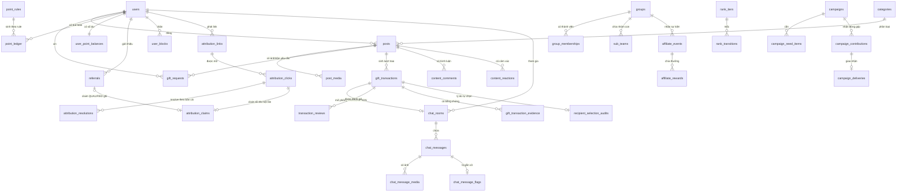
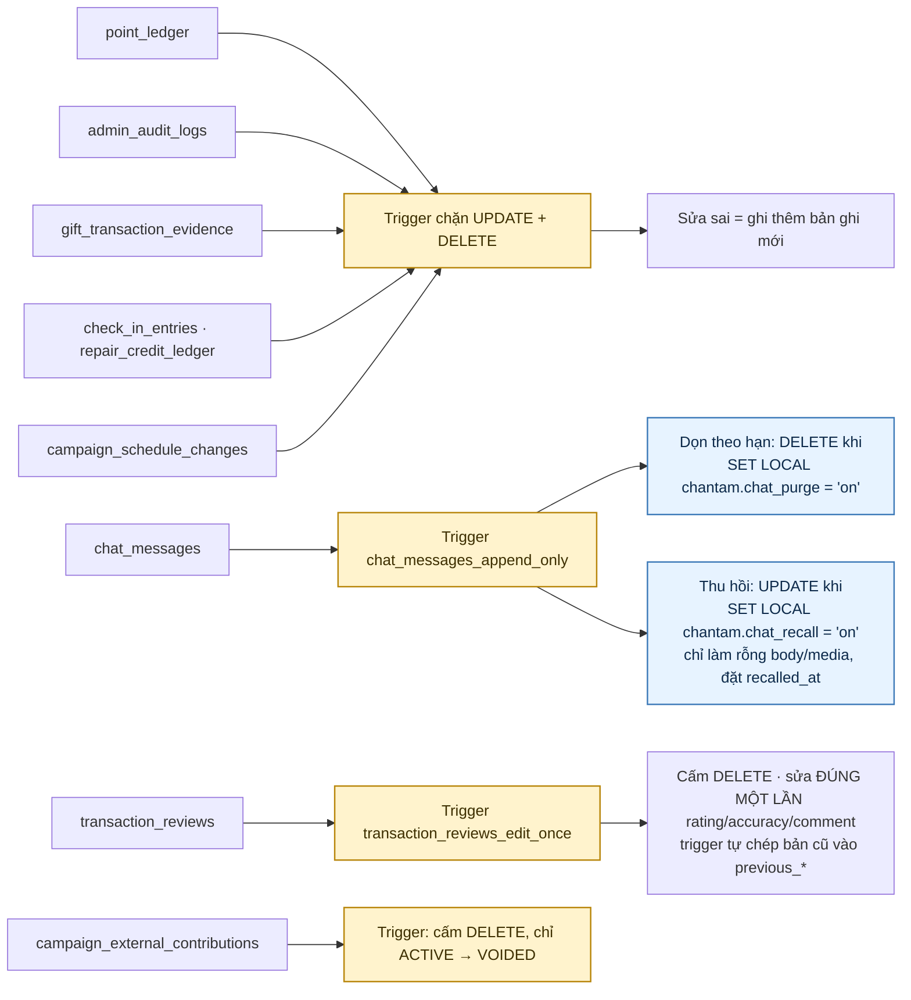
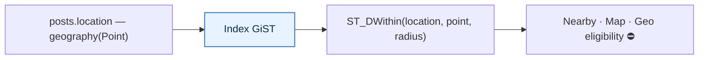

# 27 · Lược đồ database

Trạng thái: ✅ đang chạy. **Không ghi số bảng ở đây nữa** — con số đó đã lạc hậu ba lần
(25 → 28 → 44 → 52) và mỗi lần lại có người tin nó. Đếm bằng câu này:

```sql
SELECT count(*) FROM information_schema.tables WHERE table_schema = 'public';
```

Một tài liệu đếm bằng tay thì luôn chậm hơn migration mới nhất; một câu SQL thì không.
`docs/DATABASE.md` cũng không ghi con số và mô tả từng bảng theo kết quả cộng dồn của migration
(tới `1802300000000-CreateAttribution`). Các nhóm dưới đây liệt kê **mọi** bảng nghiệp vụ tại
mốc đó (không tính `migrations` và `spatial_ref_sys` của PostGIS).

## 27.1 Nhóm bảng

```mermaid
flowchart TB
    subgraph U["Người dùng & giới thiệu"]
        U1[users]
        U2[user_sessions]
        U3[verified_phones]
        U4[user_blocks]
        U5[onboarding_tasks]
        U6[user_onboarding_task_completions]
        U7[referrals]
        U8["attribution_links · attribution_clicks<br/>attribution_resolutions · attribution_claims<br/>attribution_audit_events"]
    end
    subgraph P["Nội dung"]
        P1[posts]
        P2[post_media]
        P3[categories]
        P4[gift_posts]
        P5["content_comments · content_comment_media"]
        P6["content_reactions · content_shares"]
    end
    subgraph T["Giao dịch"]
        T1[gift_requests]
        T2[gift_transactions]
        T3[gift_transaction_evidence]
        T4[transaction_reviews]
        T5[recipient_selection_audits]
    end
    subgraph C["Chat"]
        C1[chat_rooms]
        C2[chat_messages]
        C3[chat_message_media]
        C4[chat_message_flags]
    end
    subgraph PT["Điểm, hạng & điểm danh"]
        PT1[point_rules]
        PT2[point_ledger]
        PT3[point_cap_decisions]
        PT4[user_point_balances]
        PT5[rank_tiers]
        PT6[rank_transitions]
        PT7[rank_maintenance_cycles]
        PT8["check_in_entries · check_in_runs<br/>check_in_milestone_awards · check_in_policy_revisions"]
        PT9["repair_credit_cohorts · repair_credit_ledger<br/>repair_transaction_progress"]
    end
    subgraph G["Group & affiliate"]
        G1[groups]
        G2[sub_teams]
        G3[group_memberships]
        G4[group_role_permissions]
        G5["affiliate_policy_revisions<br/>affiliate_events · affiliate_rewards"]
    end
    subgraph CP["Chiến dịch từ thiện"]
        CP1[campaigns]
        CP2["campaign_need_items · campaign_media<br/>campaign_participations · campaign_coordinators<br/>campaign_beneficiaries"]
        CP3["campaign_contributions · campaign_contribution_items"]
        CP4["campaign_deliveries · campaign_delivery_items<br/>campaign_external_contributions"]
        CP5["campaign_schedule_changes · campaign_reviews"]
    end
    subgraph D["Công đức & Phật pháp"]
        D1["merit_units · merit_declarations"]
        D2["dharma_contents · dharma_recitations<br/>dharma_dedications · dharma_threads"]
    end
    subgraph L["Bảng xếp hạng tháng"]
        L1["leaderboard_snapshots · leaderboard_entries<br/>leaderboard_exclusions · user_badges"]
    end
    subgraph A["Quản trị & cấu hình"]
        A1["admin_roles · admin_permissions<br/>admin_role_permissions · admin_user_roles"]
        A5[admin_audit_logs]
        A6[system_configs]
        A7["config_bundles · config_revisions"]
        A9["capability_policies · capability_rank_values"]
    end
    subgraph N["Thông báo & báo xấu"]
        N1[notifications]
        N2[notification_channels]
        N3[notification_templates]
        N4[notification_mutes]
        N5[notification_broadcasts]
        N6[reports]
    end
    subgraph CMS["Nội dung vận hành (CMS)"]
        M1["blogs · sponsor_banners · home_campaign_configs<br/>lunar_holidays · media_assets"]
    end

    style U fill:#4682c821,stroke:#3d7ab8,stroke-width:1.5px
    style PT fill:#dcb42826,stroke:#c9a227,stroke-width:1.5px
```



## 27.2 Quan hệ lõi



`chat_rooms` có ba loại: `TRANSACTION` (gắn 1–1 lượt trao), `DIRECT_POST` (Rao vặt, không lượt
trao) và `DIRECT_USER` (hai người nhắn thẳng, không bài). `gift_requests` và `gift_transactions`
không nối bằng khoá ngoại: chọn được người thì use case tạo lượt trao từ `(post_id,
requester_id)` của yêu cầu. `point_rules`/`rank_tiers` nối theo mã, cũng không có FK.

## 27.3 Bảng append-only



`transaction_reviews` không còn bất biến tuyệt đối: từ `1799700000000-AllowReviewEditOnce` mỗi
đánh giá được sửa một lần, có ảnh chụp bản trước. `chat_messages` có hai cửa ngoại lệ, đều đòi cờ
phiên đặt bằng `SET LOCAL` trong đúng transaction đó.

> **Vì sao chặn ở trigger chứ không ở tầng ứng dụng.** Tầng ứng dụng có thể bị bỏ qua bởi một
> script chạy tay, một migration viết vội, hay một người vào psql. Trigger thì không.

## 27.4 Các ràng buộc giữ bất biến nghiệp vụ

| Ràng buộc | Giữ điều gì |
| --- | --- |
| `CHK_gift_transactions_not_self` | `giver_id <> receiver_id` — chặn tự tặng mình để farm điểm |
| `CHK_gift_transactions_completed_at` | `COMPLETED` bắt buộc có mốc hoàn tất |
| `CHK_point_ledger_balance_is_clamped_raw` | `balance_after = GREATEST(0, raw_balance_after)` |
| `CHK_posts_ship_payer_needs_shipping` | Tự đến lấy thì không khai được bên trả ship |
| `UQ_notifications_idempotency_key` | Một sự kiện chỉ ra một thông báo |
| `UQ_reports_open_reporter_target` | Mỗi người một báo xấu đang mở cho mỗi đích |
| `UQ_point_ledger_idempotency_key` | Chạy lại không cộng điểm lần hai |

> Đây là tầng phòng thủ cuối. Kiểm ở tầng ứng dụng rồi mới ghi thì hai request song song lọt
> qua được cả hai; ràng buộc database không có kẽ đó.

## 27.5 Index cho truy vấn địa lý



## Chỗ cần soát

1. ✅ **Không còn con số bảng viết tay** ở cả sơ đồ này lẫn `docs/DATABASE.md` — đếm bằng câu
   SQL ở đầu trang. `DATABASE.md` đã được đối chiếu lại với schema dựng từ toàn bộ migration
   (03/11).
2. `gift_posts` và `posts` **cùng tồn tại** vì lớp tương thích. Cần chốt bao giờ gỡ bảng cũ.
3. ✅ **Group và affiliate đã có bảng.** Group (30/09): `groups`, `sub_teams`,
   `group_memberships`, `group_role_permissions` (mã mời là `groups.invite_code`, không có bảng
   invite riêng); `chat_message_flags` cho kiểm duyệt chat. Affiliate
   (`1797400000000-CreateAffiliateEngine`): `affiliate_policy_revisions`, `affiliate_events` (chụp
   `distance_meters`/`radius_meters` lúc xét) và `affiliate_rewards` (nối `point_ledger`). Migration
   không seed policy nào, nên mặc định bộ máy chưa phát điểm.
4. ✅ **Cố ý KHÔNG có `users.last_login_at`** (chốt 30/09). Mốc dùng là `last_active_at`, ghi ở
   **mọi** lần cấp phiên chứ không riêng lúc đăng nhập — xem [17](./17-jobs.md) mục 2. Hai cột
   cho hai khái niệm gần nhau là hai nguồn sự thật, và cái ít được ghi hơn sẽ bị dùng nhầm.
5. **Chưa có chiến lược lưu trữ dài hạn / phân vùng** cho `point_ledger` và `chat_messages`,
   hai bảng chỉ tăng không giảm.
6. **Backup có, nhưng restore test chưa từng chạy** — `DEFERRED.md` liệt nó là release blocker.
